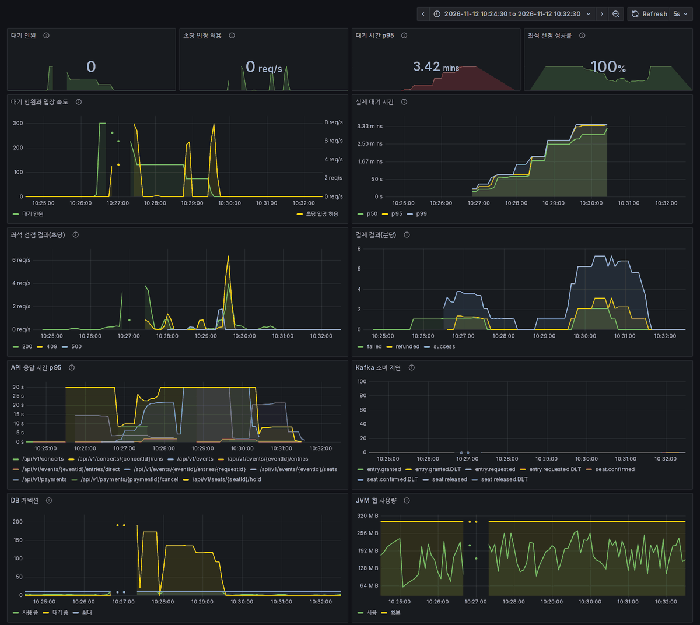
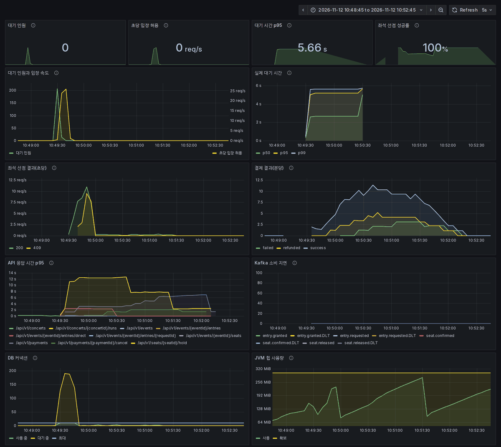

# Redis만 쓰는 서비스의 readOnly 트랜잭션이 DB 커넥션 풀을 고갈시킴

## 증상

모니터링 대시보드를 붙인 뒤 다음 부하를 걸었다.

- k6 가상 관객 300명이 대기열에 입장한다(`queue.js`).
- 동시에 좌석 25개를 하나씩 결제하고, 그중 일부는 예매를 취소한다.

이때 일어난 일:

- **500 에러 269건:** 요청의 3.43%가 실패했다. 대기 상태 조회(`GET /events/{eventId}/entries/{requestId}`)에서 233건, 좌석 선점(`POST /seats/{seatId}/hold`)에서 36건이다.
  ```
  CannotCreateTransactionException: Could not open JPA EntityManager for transaction
  Caused by: SQLTransientConnectionException: HikariPool-1 - Connection is not available,
    request timed out after 30001ms (total=10, active=10, idle=0, waiting=167)
  ```
- **커넥션 대기:** DB 커넥션 10개가 모두 사용 중이었고, 최대 192개 요청이 커넥션을 기다렸다. 대기는 140초 동안 이어졌다.
- **응답 시간:** 대기 상태 조회와 좌석 선점의 p95가 커넥션 대기 제한인 30초에 붙었다.
- **입장 속도:** 설정은 초당 100명인데, 실제로는 최대 초당 7.9명이었다.
- **대기 시간:** 평균 1분 39초, p95 3분 3초였다. 대기 화면은 "약 3초"로 안내했다.



## 원인

`EntryServiceImpl`과 `EventStatsServiceImpl`은 DB를 쓰지 않고 Redis와 Kafka만 다룬다. 그런데 다른 서비스와 같은 관례로 클래스에 `@Transactional(readOnly = true)`가 붙어 있었다.

`JpaTransactionManager`는 readOnly 트랜잭션이라도 시작할 때 DB 커넥션을 잡는다. 쿼리를 하나도 실행하지 않아도, 메서드가 끝날 때까지 커넥션을 붙잡고 있다.

- **대기 상태 조회:** 대기 화면과 k6 가상 관객이 1초마다 부른다. 300명이 기다리면 초당 300번 커넥션을 잡았다 놓는다. 부하로 Redis 응답이 조금만 느려져도 커넥션 10개가 금방 바닥난다.
- **입장 처리:** 큐 워커가 부르는 `grantEntry`도 같은 클래스라, 커넥션을 기다리는 동안 입장 처리가 멈췄다. 입장 속도가 설정보다 크게 낮았던 이유가 이것이다.
- **좌석 선점:** 실제로 DB가 필요한 좌석 선점도 같은 풀을 쓰므로, 폴링에 밀려 30초 뒤 타임아웃으로 실패했다.

## 해결

- **트랜잭션 제거:** 두 서비스에서 클래스 단위 `@Transactional(readOnly = true)`를 걷어냈다.
  - 오픈 시각 확인처럼 DB가 필요한 부분은 `EventService.getEvent()`가 자기 readOnly 트랜잭션으로 처리하므로 동작은 같다.
  - 이 프로젝트의 서비스는 "기본 readOnly 트랜잭션"을 관례로 따른다. DB를 쓰지 않는 서비스에서는 이 관례가 비용만 생기므로 예외로 두고, 이유를 클래스 주석에 남겼다.
- **회귀 테스트:** 두 서비스의 public 메서드에 트랜잭션 속성이 없는지 확인하는 테스트를 추가했다.
  - `AnnotationTransactionAttributeSource`로 검사한다.
  - 수정 전 코드로 되돌리면 이 테스트가 실패한다.

같은 시나리오로 다시 잰 결과다.

| 지표 | 수정 전 | 수정 후 |
|---|---|---|
| 요청 실패율 | 3.43% (269/7837) | 0% (0/1799) |
| 500 에러 | 269건 | 0건 |
| 대기 시간 평균 / p95 | 1분 39초 / 3분 3초 | 3.3초 / 6.0초 |
| 최대 입장 속도 | 초당 7.9명 | 초당 25.9명 |
| 대기 상태 조회 p95 | 30초(타임아웃) | 0.08초 |
| 좌석 선점 p95 | 30초(타임아웃) | 12.6초 |
| DB 커넥션 대기가 있었던 시간 | 140초 | 20초 |

전체 요청 수가 줄어든 이유는 기다리는 시간이 짧아져 대기 상태 폴링 횟수가 줄었기 때문이다.



남은 병목도 있다.

- **현상:** 입장 직후 300명이 거의 동시에 좌석을 선점하는 약 20초 동안, 커넥션 대기가 여전히 190까지 쌓이고 선점 p95가 12.6초까지 올라간다. 타임아웃(30초)에 걸린 요청은 없다.
- **원인:** 좌석 선점은 실제로 DB를 써야 하는 작업이라 이번 수정의 대상이 아니다.
- **다음 후보:** 선점 트랜잭션 안에서 하는 Redis 호출을 줄여 커넥션을 쥐는 시간을 줄이거나, 커넥션 풀 크기를 조정한다.

## 참고

- 측정 환경: 로컬 PC 한 대에서 앱(`-Xmx512m`), MySQL, Redis, Kafka, Prometheus, Grafana, k6를 함께 실행했다. 절대 수치보다 같은 조건에서의 전후 차이를 본다.
- [모니터링 트레이드오프](../trade-offs/2026-11-12-monitoring-prometheus-grafana.md)
